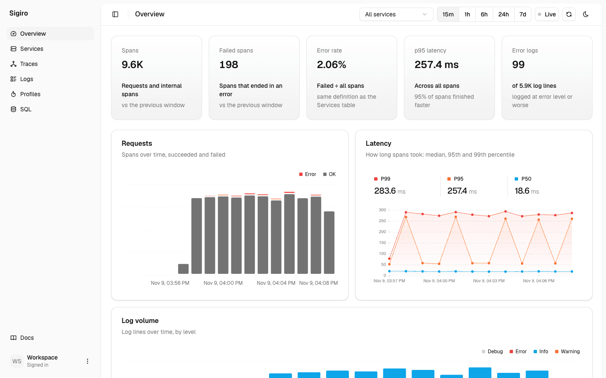
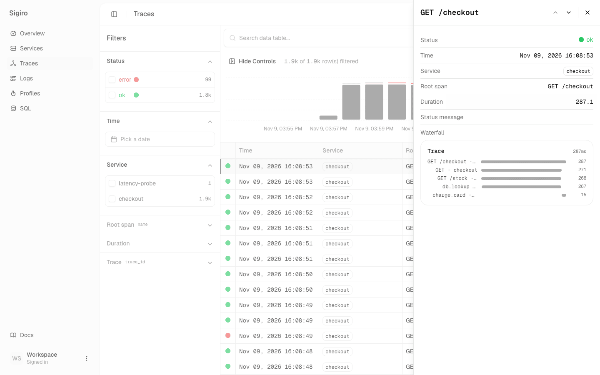
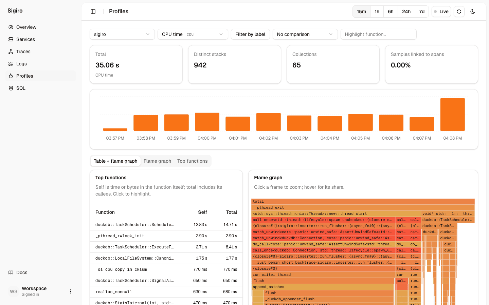

# Sigiro

An OpenTelemetry backend you can hand to a coding agent.
One binary takes in traces, logs, metrics and profiles over OTLP.
You read them back with SQL, a dashboard, a CLI, or MCP.



## Run it

```bash
curl -fsSL https://sigiro.com/install | sh
sigiro serve
```

No account and no config. It listens on:

| Port | What |
|---|---|
| `4317` | OTLP gRPC |
| `4318` | OTLP HTTP |
| `9999` | dashboard (`/dashboard/`), HTTP API, `/health` |

Data goes to `~/.local/share/sigiro` on Linux and `~/Library/Application Support/sigiro` on macOS.
Change it with `--data-dir` or `SIGIRO_DATA_DIR`.
There is no login on a self-hosted server, so keep it on localhost or a private network.

## Send it telemetry

Point any OpenTelemetry SDK or Collector at it:

```bash
export OTEL_EXPORTER_OTLP_ENDPOINT=http://localhost:4318
```



Data is kept for 7 days. Set `SIGIRO_RETENTION_DAYS=0` to keep it all.

## Look at it

Open <http://localhost:9999/dashboard/>.



Click a trace to see its waterfall:



Profiles get a flame graph. This one is sigiro profiling itself:



## Ask it

SQL over HTTP. The body is one `SELECT`:

```bash
curl -s localhost:9999/v1/query --data-binary \
  "SELECT service_name, count(*) AS spans FROM sigiro_spans GROUP BY 1 ORDER BY 1"
```

```json
[{"service_name":"checkout","spans":6759},{"service_name":"inventory","spans":4502},{"service_name":"latency-probe","spans":1}]
```

Give your agent the MCP server (`list_services`, `run_query`, plus docs search):

```bash
claude mcp add sigiro -- sigiro mcp
```

Check that data is arriving:

```bash
sigiro status
```

The CLI prints JSON. The tables are listed in the
[telemetry tables reference](https://sigiro.com/docs/reference/telemetry-tables).

> If you have signed in to sigiro.com, the CLI and MCP talk to it instead.
> Set `SIGIRO_ENDPOINT=http://localhost:9999` to use your own server.

## Hosted

Don't want to run it? Use the hosted service at [sigiro.com](https://sigiro.com):

```bash
sigiro signup --name "Your Name" --email you@example.com
```

Docs: <https://sigiro.com/docs>.

## Build from source

Toolchains are pinned in `mise.toml`. With [mise](https://mise.jdx.dev):

```bash
git clone https://github.com/akshatagarwl/sigiro.git
cd sigiro
mise trust && mise install
mise run build                     # release binary with the dashboard built in
./target/release/sigiro serve
```

`mise run build-dev` is a faster debug build. It embeds the dashboard only if `mise run dashboard-build` ran first.
Checks and the repo layout are in [CONTRIBUTING.md](CONTRIBUTING.md).
Words used in the code are defined in [CONTEXT.md](CONTEXT.md).
Report security issues as described in [SECURITY.md](SECURITY.md).

## License

[FSL-1.1-ALv2](LICENSE.md), © 2026 Akshat Agarwal.
Use it for anything except a competing commercial product.
Each version becomes Apache 2.0 two years after its release.
