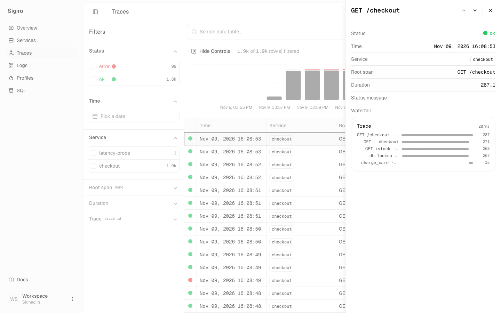
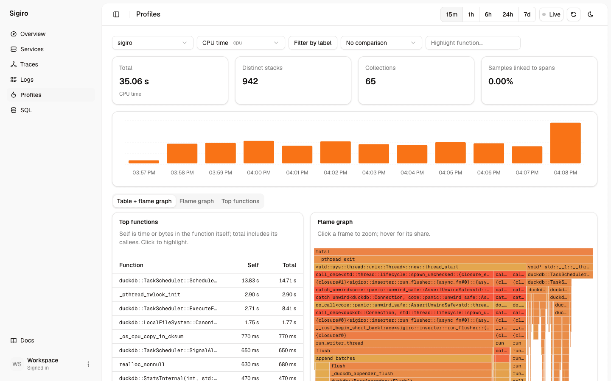

# Sigiro

An OpenTelemetry backend you can hand to a coding agent.
One binary takes in traces, logs, metrics and profiles over OTLP.
You read them back with SQL, a dashboard, a CLI, or MCP.


## Run it

```bash
curl -fsSL https://sigiro.com/install | sh
SIGIRO_BIND=127.0.0.1 sigiro serve
```

No account or configuration file is required. This command keeps the unauthenticated
server on loopback. It listens on:

| Port | What |
|---|---|
| `4317` | OTLP gRPC |
| `4318` | OTLP HTTP |
| `9999` | dashboard (`/dashboard/`), HTTP API, `/health` |

Data goes to `~/.local/share/sigiro` on Linux and `~/Library/Application Support/sigiro` on macOS.
Change it with `--data-dir` or `SIGIRO_DATA_DIR`.
Self-hosted open mode requires no hosted login or token. Do not expose its ports
to an untrusted network; remote access needs a trusted network perimeter or an
authenticating proxy. Set `SIGIRO_BIND` explicitly: on Linux and macOS, leaving
it unset currently listens on every interface; Android defaults to loopback.

## Send it telemetry

Point any OpenTelemetry SDK or Collector at it:

```bash
export OTEL_EXPORTER_OTLP_ENDPOINT=http://localhost:4318
export OTEL_EXPORTER_OTLP_PROTOCOL=http/protobuf
export OTEL_SERVICE_NAME=checkout
```

Use a shell without hosted exporter authorization headers. Local ingestion needs
no `sigiro auth login` or `sigiro auth token`. Port `4318` is for OTLP/HTTP;
`4317` is for OTLP/gRPC. Neither the dashboard port nor a frontend preview port
is an ingestion endpoint.


Data is kept for 7 days. Set `SIGIRO_RETENTION_DAYS=0` to keep it all.

## Microcontroller ingress (experimental)

The same host binary can receive MCU batches through an authenticated MQTT 5
broker, retain their original OTLP bytes, and acknowledge durable raw recording
before asynchronous query projection:

```sh
sigiro serve --micro-config /etc/sigiro/micro.json
sigiro micro status --data-dir /var/lib/sigiro
```

See [configuration, receipt semantics and QEMU tests](docs/micro.md). The portable
outbox and target-specific firmware are MIT/Apache-2.0; host code remains FSL.
This self-hosted milestone is not physical-board certification or exactly-once
indexing. Raw MCU recording retention has its own quotas and is independent of
the ordinary 7-day query retention.

## Look at it

Open <http://localhost:9999/dashboard/>. Navigation has five destinations:
Overview, Traces, Logs, Profiles, and SQL. There is no separate Services or Metrics
page; use Overview for summaries and SQL for the stored telemetry tables.

Overview starts with all services, the last 24 hours, and live refresh off. It
shows loading and query failures separately from a successfully loaded empty
window. If it is empty, check the exporter destination, selected service, and time
range; data outside that scope will not appear. Enable Live for refreshes every
10 seconds, or refresh manually. SQL defines its own query window.

**Current local-dashboard caveats:** the empty-state instructions still describe
hosted ingestion and must not be used to configure your local exporter. Follow
[the local quickstart](https://sigiro.com/docs/tutorials/quickstart) instead. A
standalone frontend preview also needs a working same-origin backend; a Sign in
card there can reflect failed local-server detection rather than a requirement
to create a hosted account. See the existing [entry and first-run inventory](docs/dashboard-state-machines.md#current-entry-and-first-run-behavior)
for current behavior and pending fixes. Documentation is available at
<http://localhost:9999/docs/> when served by the binary, or at
<https://sigiro.com/docs>.


Click a trace to see its waterfall:



Profiles get a flame graph. This one is sigiro profiling itself:



## Ask it

SQL over HTTP. The body is one `SELECT`:

```bash
curl -s localhost:9999/v1/query --data-binary \
  "SELECT service_name, count(*) AS spans FROM sigiro_spans GROUP BY 1 ORDER BY 1"
```

```json
[{"service_name":"checkout","spans":6759},{"service_name":"inventory","spans":4502},{"service_name":"latency-probe","spans":1}]
```

Give your agent the MCP server (`list_services`, `run_query`, plus docs search):

```bash
claude mcp add sigiro -- sigiro mcp
```

Check that data is arriving:

```bash
sigiro status
```

The CLI prints JSON. The tables are listed in the
[telemetry tables reference](https://sigiro.com/docs/reference/telemetry-tables).

> If you have signed in to sigiro.com, the CLI and MCP talk to it instead.
> Set `SIGIRO_ENDPOINT=http://localhost:9999` to use your own server.

## Hosted

Don't want to run it? Use the hosted service at [sigiro.com](https://sigiro.com):

```bash
sigiro signup --name "Your Name" --email you@example.com
```

Docs: <https://sigiro.com/docs>.

## Build from source

Toolchains are pinned in `mise.toml`. With [mise](https://mise.jdx.dev):

```bash
git clone https://github.com/akshatagarwl/sigiro.git
cd sigiro
mise trust && mise install
mise run build                     # release binary with the dashboard built in
SIGIRO_BIND=127.0.0.1 ./target/release/sigiro serve
```

`mise run build-dev` is a faster debug build. It embeds the dashboard only if `mise run dashboard-build` ran first.
Checks and the repo layout are in [CONTRIBUTING.md](CONTRIBUTING.md).
Words used in the code are defined in [CONTEXT.md](CONTEXT.md).
Report security issues as described in [SECURITY.md](SECURITY.md).

## License

[FSL-1.1-ALv2](LICENSE.md), © 2026 Akshat Agarwal.
Use it for anything except a competing commercial product.
Each version becomes Apache 2.0 two years after its release.
