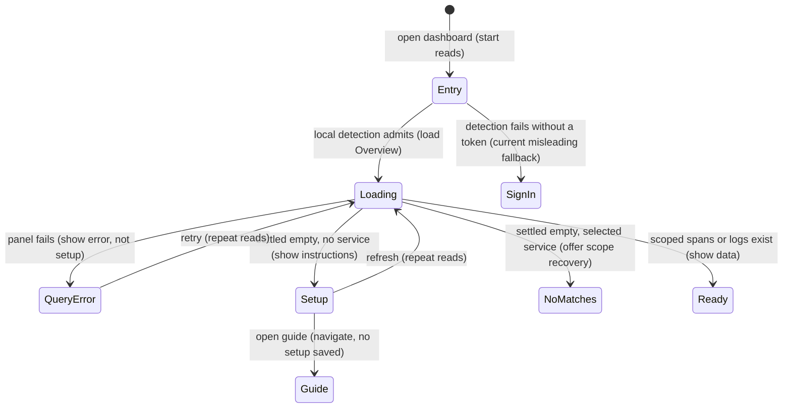

# Dashboard state / transition inventory

## Current entry and first-run behavior

This section describes the user-facing behavior on `main` at `239cf44c3`, not a
new implementation. The six-route inventory below is historical: the Services
page was subsequently removed. The current dashboard has **five routes** under
`/dashboard/`: Overview, Traces, Logs, Profiles, and SQL. There is still no Metrics
explorer. The separate `feat/dashboard-ui-sdk` worktree contains uncommitted
entry/auth and primitive-migration changes; its successful tests do not establish
that those changes are present on `main`.

### Vocabulary and state ownership

- **Local open mode:** the self-hosted backend admits requests without a hosted
  account. It still needs a protected network perimeter.
- **Scope:** the service and time window used for a view. Default Overview scope
  is all services and the last 24 hours, with live refresh off.
- **Empty:** all five Overview panel queries have succeeded and stopped
  fetching, with zero spans and logs in scope. Empty is not failed, loading, or
  a server-wide assertion about every signal.
- **Snapshot:** a previously returned value retained during a same-scope refresh,
  not proof that the new request succeeded.
- **Setup:** first-export guidance in a settled empty Overview without a service
  restriction. It is not an editable configuration form or a persisted wizard.

| User-facing area | Owner | Behavior on current `main` |
| --- | --- | --- |
| Entry | `components/sigiro/auth-gate.tsx`, `lib/sigiro/query.ts` | Starts with Signing in; loopback open-server detection can admit without an account. Failed detection can fall through to hosted sign-in. |
| Navigation | `components/app-sidebar.tsx`, `components/nav-main.tsx` | Five destinations; selected route is marked. Current scope is carried only where supported; same-route links retain current parameters. |
| Shared scope | `lib/sigiro/controls.tsx`, `components/site-header.tsx` | Service/time/live/refresh; Live opts into a 10-second refresh interval. SQL defines its own time. |
| Invalid time | `components/sigiro/app-shell.tsx` | Non-SQL content is replaced by Invalid time range; header remains for recovery. SQL is not blocked by this guard. |
| Overview readiness | `app/page.tsx` | Loading, updating, error, ready, and settled empty are distinct. Selected-service empty results offer scope recovery rather than generic setup. |
| First export | `components/sigiro/setup-empty.tsx` | Static instructions and guide link; no editable draft, Submit, Copy command, or completion flag. Current copy is hosted-specific even in local mode. |
| Workspace actions | `components/nav-user.tsx` | Switch workspace and Sign out are not currently hidden for open mode; do not mistake them for required local setup. |

> Technical note: current `main` detects local access by a loopback-only
> unauthenticated query probe and uses a placeholder bearer for subsequent
> queries. It does not yet have the explicit `/v1/auth/config` bootstrap,
> credential-free local query headers, Local Sigiro label, or connection-retry
> card exercised in the uncommitted worktree. These are pending implementation,
> not documentation claims about a shipped release. The current standalone Next
> configuration also does not proxy backend requests automatically.

### The first-run lifecycle

1. **Arrive:** open the dashboard served by the binary at
   `http://localhost:9999/dashboard/`. A frontend-only preview must separately
   provide the same-origin API; otherwise detection can fail even though local
   usage does not require an account.
2. **Leave untouched:** initial reads may already run, but no account, exporter,
   product configuration, or onboarding-completed record is created merely by
   opening or reading the page.
3. **Begin interacting:** wait for Overview to settle, then inspect Setup if the
   current scope has no spans/logs. A selected service with no matches instead
   offers another service/time choice. Loading or a query error is not setup.
4. **While interacting:** inspect the snippet or choose a scope/refresh action.
   Reading the snippet does not execute it. On mobile, the summary cards precede
   setup and long commands can require horizontal scrolling. The current hosted
   endpoint and token commands are wrong for local ingestion; follow the
   [local quickstart](../www/docs/tutorials/quickstart.mdx) instead.
5. **Finish:** a later successful read with spans/logs replaces Setup with data.
   With Live off, no immediate push update is promised. Following the guide is
   browser navigation, not an installation, login, or completion action.

### Variants and interrupts to verify

The same lifecycle must be checked at arrival and after an action starts. Known
behavior and unverified cases must not be conflated.

| Variant/event | Established behavior or verification boundary |
| --- | --- |
| Backend unavailable or request failure | Entry detection can currently show Sign in; a later Overview failure has its own query error. Do not infer an account requirement or successful emptiness from either failure. |
| Stored hosted token | Current entry checks it before local detection. Credential clearing/exclusion is a pending follow-up, not a verified guarantee on `main`. |
| Selected service/time | Empty is scoped; new scope must not inherit old data labeled as new. Custom-window setup titles need the follow-up check below. |
| Viewport/input | Check desktop, 390px mobile, keyboard, and a named screen reader separately. An emulated viewport is not physical touch evidence. |
| Escape | No setup or entry Cancel action. Menu/picker dismissal belongs to the relevant control; verify focus return independently. |
| Browser Back/Forward | Browser history is not product undo. Exact scope, disclosure, focus, and scroll restoration need direct checks. |
| Reload | Re-enters the gate and reloads current view; reading Setup is not remembered as completed onboarding. Relative now is evaluated again. |
| Close tab/window | No entry/setup editable draft or corresponding Save/Discard prompt; no exporter is started. |
| In-app navigation | Leaves the view without a setup-save step. Preserve only the scope supported by the current navigation implementation. |
| Network loss or timeout | Record initial-load and refresh failures separately. A loading indicator, stale snapshot, and empty response are different outcomes. |
| Session expiry | Local backend access has no hosted session requirement. Do not generalize hosted expiry behavior to the account-free local workflow. |
| Another tab | No shared onboarding-completed flag. Check preference synchronization and tab-scoped credentials separately. |
| Telemetry changes elsewhere | Subsequent reads can observe it; no guaranteed immediate push. Metrics/profiles alone do not enter Overview's span/log empty predicate. |
| Autofill | Entry/setup have no editable fields; explorer/editor inputs are separate features. |
| Window loses focus | Not an intentional logout/setup-completion action. Refetch timing, live background timers, and focus restoration remain unverified. |

### Open questions and verification

The [existing checkpoint report](dashboard-wide-checkpoint.md#entry-and-first-run-follow-up)
collects follow-up defects, source causes, verification IDs, and decision needs.
No full manual pass, screen-reader pass, real populated-profile check, or packaged
release verification is implied by these descriptions. The worktree's scripted
results must stay labeled separately from current `main` behavior. Do not execute
hosted setup commands to reproduce a local copy defect.

## Historical six-route inventory

Starting checkpoint: `c92d64ee69ade67e99a7d9bc7a4c7c299b6441fc` (completed results-first Logs iteration, still local). Expanded user scope: the **whole existing dashboard**, not only logs. Solo execution; environment verified `PI_MODEL=gpt-6.1-sol`, `PI_REASONING_LEVEL=medium`. No delegation, push, PR, merge, deployment, publication or backend/auth/tenant rewrite.

This is a working inventory and bounded fix plan, **not an assertion that every implicit state machine has been found or fixed**. Initial source inspection and actual-browser inventory happened before broad changes. The initial six-route desktop/mobile inventory used real backend responses. Its retained [baseline observations](assets/observability-ui/dashboard-wide/baseline-observations.json) and [window/filter probes](assets/observability-ui/dashboard-wide/baseline-window-probes.json) are distinct from the current screenshots. The temporary capture directory was reused; it is not a durable before-screenshot set.

## Actual routes and state owners

| Route        | Source / state owner                                                      | States and transitions to check                                                                                                                                                            | Baseline browser                                                                                                                                                                           |
| ------------ | ------------------------------------------------------------------------- | ------------------------------------------------------------------------------------------------------------------------------------------------------------------------------------------ | ------------------------------------------------------------------------------------------------------------------------------------------------------------------------------------------ |
| `/` Overview | `app/page.tsx`, `lib/sigiro/controls.tsx`, five React Query SQL panels    | Header range/service/live/refresh → SQL window; concurrent loading/success/partial failure/empty; prior-window KPIs; clickable chart legends                                               | Real span/log KPIs and charts, desktop + mobile; normal vertical chart scrolling is expected                                                                                               |
| `/services/` | `app/services/page.tsx`, `DataTableAuto`, memory adapter                  | Two concurrent aggregates → merge → table; loading/failure/empty/retry; client filter/sort/column preference; selection/detail across refresh                                              | One actual `dashboard-e2e` aggregate; desktop + mobile; fixed-screen child table overflows document height                                                                                 |
| `/traces/`   | `traces-table.tsx`, `createExplorer`, Nuqs adapter, `app/traces/page.tsx` | URL filter/date → parser → SQL/facets/count → cursor append; uuid/trace → controlled sheet; span URL → workspace; close/history/deep link/focus                                            | Two actual root traces; desktop + mobile; unknown service URL incorrectly returns both real roots                                                                                          |
| `/logs/`     | `logs-table.tsx`, `createExplorer`, Nuqs adapter, MIT EventExplorer       | URL filters/time/selection → actual SQL; pagination; inline/mobile details; loaded find; copy; close/history/focus                                                                         | Completed previous checkpoint; preserve +456px desktop/laptop results gain and mobile improvements                                                                                         |
| `/profiles/` | `profiles-explorer.tsx`, `profiles.ts`, flamegraph adapter                | Services discovery → chosen service → type discovery → stacks/summary/timeline/labels; custom vs header time; compare baseline; view URL vs local highlight/zoom; loading/error/no samples | Backend genuinely has no profiles in the default window. Empty setup captured desktop/mobile; populated states require clearly labeled browser fixtures unless real data becomes available |
| `/sql/`      | `app/sql/page.tsx`, `DataTableAuto`                                       | Idle draft → running → result/empty/error; keyboard vs disabled button; concurrent responses/unmount; executed SQL vs edited draft; client filters/sort/schema/selection                   | Default real read-only SELECT returns one aggregate row; desktop/mobile; results table adds another full viewport below editor                                                             |

There is **no Metrics route**. RED metrics are span-derived Overview/Services panels. `sigiro_metrics_histogram` is listed as an existing SQL-query table, not a fabricated metrics explorer.

## Cross-view machines / ownership

The following describes the starting checkpoint; the closeout below records changes and remaining boundaries.

1. **Header controls:** Nuqs `range`, `service`, `live`; local `now`/`tick` moves relative windows. `useSql` uses SQL text as cache identity. Explicit explorer `timestamp` and Profiles `from`/`to` currently override the header silently when the operator changes range.
2. **Navigation/history:** URL router, shared header range/live, app rail open/closed, mobile navigation overlay, scroll ownership and focus restoration. Range/service input commits currently generally replace URL history; Back is not promised to undo every keystroke. Explicit navigation/deep-link entries must restore correctly.
3. **Server explorer adapter:** Nuqs table state, TanStack Infinite Query pages and metadata; query identity vs selection; row IDs vs mounted virtual DOM; retry/refresh/live; fallback relative window vs explicit timestamp. No transport capability should be implied by unsupported sorting/exclusion controls.
4. **Client result tables:** inferred schema, memory filter/sort/selection, local-storage visibility/order, current dataset identity. Services and SQL currently share the `auto` storage namespace. A selected row can become stale when dataset data changes without its ID changing.
5. **Trace workspace:** trace fetch validity/loading/failure/retry/empty/cap; URL span fallback; local tree collapse/search/errors/zoom; resizable desktop panes; mobile containing sheet; input/output/events/attributes tabs; log/profile correlation links. Existing engines stay specialized.
6. **Profiles dependency graph:** queries enabled only after discovery; explicit vs implicit service/type; cached prior query data vs newly labeled selection; compare baseline enabled/disabled; valid/invalid custom range; trace/span/label chips and clear paths; table/flamegraph/view URL; local highlight/zoom reset.
7. **Request lifecycle:** initial pending, success, updating old success, failure with/without old data, retry, empty. A failed request must not masquerade as zero samples or leave unexplained loading forever. Scope changes must not label old results as new data.
8. **Auth/workspace gate:** already has a tagged boot/sign-in phase and workspace behavior. Inventory boundary only; no auth protocol, credential storage, tenant or server changes authorized here. Synthetic request failures must not intercept the gate's health query and impersonate an auth defect.
9. **Overlay/focus:** navigation, facets/calendar, trace detail, result-property detail, Base UI event dialog, menu/popover. Open/close/route change/resize/virtual remount are distinct transitions. Legacy primitives remain partial migration, not blanket Base UI replacement.

## Concrete findings and bounded next work

Status at initial inventory: source findings below are **not yet fixed** except earlier Logs checkpoint items. Browser evidence is distinguished from source observations.

| ID  | Finding / evidence                                                                                                                                                                                                                                                                                | Planned UI-only action                                                                                                                                                             | Verification                                                                                                                       |
| --- | ------------------------------------------------------------------------------------------------------------------------------------------------------------------------------------------------------------------------------------------------------------------------------------------------- | ---------------------------------------------------------------------------------------------------------------------------------------------------------------------------------- | ---------------------------------------------------------------------------------------------------------------------------------- |
| D1  | **Real + source:** explorer header Refresh changes cursor time, but its first `timestamp >=` / `timestamp <` SQL window bounds stay frozen. `useOptions` memo captures `from`/`to` but only depends on range. Comparing whole SQL strings hides this because the cursor clause changes.           | Refresh/live must re-read current relative bounds; preserve explicit timestamp windows and SQL contract                                                                            | Capture actual first two bounds before/after delayed refresh, Logs + Traces; explicit windows stay fixed                           |
| D2  | **Real + source:** `/traces/?service=missing-ui-inventory-service&timestamp=...` shows both real roots, and actual SQL has no service predicate. Same empty-enum parser defect previously fixed only in Logs.                                                                                     | Traces-only dynamic string-array filter override                                                                                                                                   | Real known/missing/quote service URL, checkbox, reload/history; inspect actual outgoing SQL                                        |
| D3  | **Source:** header range setters do not clear explicit Logs/Traces `timestamp` or Profiles `from`/`to`. Visible header selection and actual query window disagree. SQL header controls also appear applicable despite SQL defining its own time.                                                  | Explicit user range selection clears view-local time overrides atomically; accurately label SQL as independently scoped                                                            | Actual outgoing window after header range choice; reload/history; custom profile range; SQL UI does not imply unused refresh/live  |
| D4  | **Source:** Overview errors coexist with a misleading loading/ready marker; Services returns only raw error with no local retry; Profiles never renders query errors and can show no samples/zero instead                                                                                         | Shared Base UI-backed request-state presentation; explicit retry/loading/empty/updating states per existing query graph                                                            | Real empty where possible; clearly synthetic failed/retry/delayed responses for deterministic coverage                             |
| D5  | **Source:** Profiles silently substitutes the first discovered service/type when an explicit URL choice is absent; `placeholderData` can display prior-service results with a new selection label. Compare loading ignores baseline queries; invalid/incomplete custom range silently falls back. | Preserve explicit scope, gate dependent queries on matching current discovery, show true pending/error/no-data states, make invalid range clearable; do not invent profile samples | Real no-profile state and trace deep link; synthetic two-service/type/compare delays/errors and empty; reload/back/forward         |
| D6  | **Source:** SQL keyboard submit bypasses disabled Run, permitting overlapping requests; late responses can overwrite newer results; unmount has no cancellation; failed query can leave old result table beneath new error                                                                        | Explicit request lifecycle, single-flight keyboard/button parity and abort on unmount; identify executed query separately from draft; unambiguous empty/error                      | Real read-only success/empty/invalid SELECT; synthetic delayed/racing responses and navigation; keyboard                           |
| D7  | **Source:** Services/SQL share `auto` local-storage keys and broad fixed-screen table layout; row-index selection and memoized row lookup risk stale details after updated data                                                                                                                   | Explicit table namespace/dataset row identity; data-reactive details; compact opt-in facets and bounded result region                                                              | Distinct column preferences, real client sort/filter, refresh detail, SQL rerun new schema, empty result                           |
| D8  | **Real + source:** only Logs currently has compact default rail/facets and bounded viewport. Other tables push footers below viewport; trace sheet is controlled without a row focus-return anchor                                                                                                | Shared compact shell/layout direction across existing views; preserve legitimate Overview/Profile page scrolling and Laminar split workspace; trace close focus anchor             | Six-view screenshots, desktop/mobile; navigation/back/reload; trace row keyboard/close/retry/empty/invalid and existing regression |

### Boundaries to flag rather than silently redesign

- Overview/Services use a single service string while Logs/Traces can select multiple services. Existing navigation retains only range/live and drops service, even between Overview and Services. Preserve compatible single-service context first; do not pretend a multi-service selection is representable by the existing single-service panels. A deliberate cross-view scope policy is still needed.
- Explorer pagination uses a `(timestamp, key)` keyset cursor (`keysetPagination` in `lib/sigiro/table-source.ts`; each `SqlSource` names its tiebreak `key`), so rows tied at a page boundary are not skipped. No arbitrary server-sort capability will be invented.
- No real populated profile data exists in the inspected local window. Flamegraph/diff interactions can be verified only with labeled fixtures, not claimed as real backend profile evidence.
- Complete payload/resource/security/accessibility audits, every browser, every viewport and every possible transition are not covered by a route inventory. Keep individual tested/untested cases explicit.

## Explorer results machine

`lib/sigiro/explorer-state.ts` names the explorer's results states as one union derived from the TanStack infinite query (`explorerView`). React Query is the request machine; the union is the only thing the slots read.

| State | Shown | Load-more control |
| --- | --- | --- |
| `loading` | "Loading results…" | none |
| `failed` (`retrying`) | table-level error with Retry | none |
| `empty` (`refreshing`) | "No matching …" | none |
| `rows`, `more: idle` | rows | Load more |
| `rows`, `more: loading` | rows | Loading… (disabled) |
| `rows`, `more: failed` | rows | inline error + Retry at the bottom |
| `rows`, `more: end` | rows | "No more events in this query." |
| `rows`, `refreshing` | rows, unchanged control | unchanged |
| `rows`, `refreshError` | rows + "Unable to refresh" banner | unchanged |

A header refresh or live tick only sets `refreshing`; it never changes `more`. A failed next page only sets `more: failed`; it never raises the table banner. `tests/explorer-state.test.mjs` covers every row of this table.

## Per-view bounded transition gates

All six routes were accounted for; checks below identify real versus intercepted evidence. They are not a claim of exhaustive transition coverage.

- [x] Overview: real KPIs/charts and selected-service empty state; compatible service/range navigation, reload/back/forward; injected KPI failure → retry → actual backend success. All three viewport defaults captured. Chart-legend interaction is not separately reverified in this pass.
- [x] Services: real aggregate table and empty service; injected failure/retry; synthetic two-service client filter/sort, stable-ID detail update during live tick, close focus, persisted columns isolated from a real SQL SELECT with the same column name. All three viewport defaults captured.
- [x] Traces: actual known/missing/quoted service SQL and reload; checkbox include/removal; relative/explicit time refresh; header range removes explicit window; row Enter/open/Escape/focus; injected list/detail/related-profile failure and retry with actual workspace recovery. Existing 82/2,102-span backend workload regression passes, including invalid/empty and desktop/mobile correlation flows.
- [x] Logs: previous results width, inline inspection and mobile first-row/list-height gains retained; actual moving/fixed SQL windows; existing real filters, keyboard, focus, themes and scoped axe checks; synthetic pagination/hostile payload and standalone graph/value checks rerun. Injected failed request is no longer labeled successful empty/end-of-results.
- [x] Profiles: real no-profiles setup and trace/span/service/window deep link, not real populated samples. Labeled fixtures cover two services, explicit missing service/type without fallback, delayed scope change/baseline, error/retry, labels, view reload/history, native-button function highlighting, reset zoom, invalid custom time/correlation and header time reset. Desktop/mobile populated cases; all three real default viewports captured.
- [x] SQL: actual read-only SELECT success/empty/error and keyboard; draft versus executed-query identity/disclosure; single-flight repeated shortcuts, Cancel/rerun and unmount abort with delayed fixtures; new-schema and column-namespace checks. All three viewport defaults captured.
- [x] Shared shell: compact default rail across all routes, per-table opt-in facets, visible active filters, fixed header/results shell and legitimate inner page scrolling; existing mobile navigation/facet/detail focus/dismissal regression passes. Compatible single-service views retain service; Logs/Traces retain their shared serialized service and explicit timestamp. Active-route links retain the current state and close navigation.

## Evidence / report

The [dashboard-wide report](dashboard-wide-checkpoint.md) records the completed bounded changes, commands, evidence, current source/build fingerprints and remaining gaps. [31 recorded checks](assets/observability-ui/dashboard-wide/dashboard-results.json) distinguish real backend flows, injected failures and synthetic profiles/service aggregates. There are 18 real route/viewport captures and 20 scoped axe runs with zero recorded violations, not a whole-product accessibility certification.

D1's baseline actual bounds were identical before/after refresh (`1794170190460000`, `1794256590460000`), although the third cursor clause advanced. D2's missing-service URL query omitted `service_name IN (...)` and showed two real traces. Both now have actual outgoing-SQL checks. D3–D8 have the per-view gates above; optional related-profile request failure is now explicit without hiding the trace workspace.

No server, auth, tenant, SQL-builder or cursor-transport files changed. Specialized trace/chart/flamegraph engines and their license notices remain. The UI remains a partial Base UI migration. Cross-group service/time policy, timestamp ties and real populated profile validation remain explicitly deferred, not silently declared fixed.
