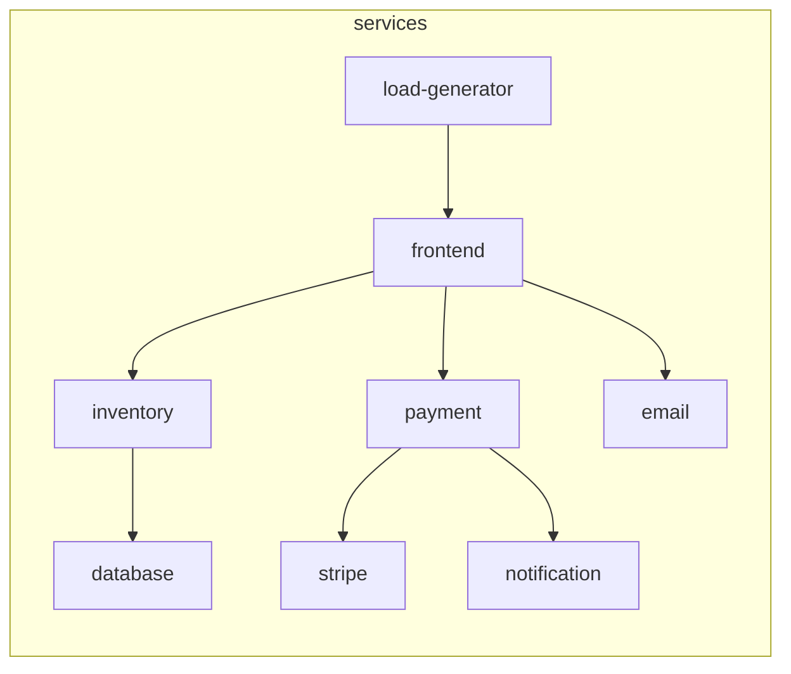

# Service Topology and Dependencies

Map, visualize, and analyze service-to-service dependencies from distributed trace data. No manual configuration — topology is inferred from span `trace_id` and `span_kind` relationships.

---

## Prerequisites

```sh {"name":"setup"}
export SIGIRO_ENDPOINT="${SIGIRO_ENDPOINT:-http://localhost:9999}"
# Hosted only: export SIGIRO_API_KEY=sk_<tenant>_<random>
# Authorization headers below are ignored by this local Open endpoint.
# Verify cross-service traces exist
XSVCS=$(sigiro query "SELECT count(DISTINCT trace_id) FROM lake.sigiro_spans GROUP BY trace_id HAVING count(DISTINCT service_name) > 1 LIMIT 1" | grep -oE '[0-9]+' | head -1)
echo "Traces with multiple services: ${XSVCS:-0}"
```

---

## 1. Service Discovery

### List all services

```sh {"name":"list-services"}
sigiro query "SELECT DISTINCT service_name FROM lake.sigiro_spans ORDER BY service_name"
```

### Service activity summary

```sh {"name":"service-summary"}
sigiro query "
SELECT
  service_name,
  count(*) AS spans,
  count(DISTINCT trace_id) AS traces,
  min(timestamp)::VARCHAR AS first_seen,
  max(timestamp)::VARCHAR AS last_seen
FROM lake.sigiro_spans
GROUP BY service_name
ORDER BY spans DESC
"
```

### Services with their resource attributes

```sh {"name":"service-resources"}
sigiro query "
SELECT
  service_name,
  ANY_VALUE(resource_attributes::JSON->>'service.namespace') AS namespace,
  ANY_VALUE(resource_attributes::JSON->>'deployment.environment') AS env,
  count(DISTINCT service_instance_id) AS instances
FROM lake.sigiro_spans
GROUP BY service_name
ORDER BY service_name
"
```

---

## 2. Dependency Detection

Dependencies are inferred from traces: if service A has a `CLIENT` or `PRODUCER` span in the same trace as service B, A depends on B.

### Downstream dependencies for one service

```sh {"name":"deps-downstream"}
SERVICE="frontend"
sigiro query "
SELECT DISTINCT s2.service_name AS dependency
FROM lake.sigiro_spans s1
JOIN lake.sigiro_spans s2 ON s1.trace_id = s2.trace_id
WHERE s1.service_name = '${SERVICE}'
  AND s2.service_name != '${SERVICE}'
  AND s1.span_kind IN (3, 4)
ORDER BY dependency
"
```

### Upstream dependents (who calls this service)

```sh {"name":"deps-upstream"}
SERVICE="frontend"
sigiro query "
SELECT DISTINCT s1.service_name AS caller
FROM lake.sigiro_spans s1
JOIN lake.sigiro_spans s2 ON s1.trace_id = s2.trace_id
WHERE s2.service_name = '${SERVICE}'
  AND s1.service_name != '${SERVICE}'
  AND s1.span_kind IN (3, 4)
ORDER BY caller
"
```

### Full dependency matrix

```sh {"name":"deps-matrix"}
sigiro query "
SELECT
  s1.service_name AS caller,
  s2.service_name AS callee,
  count(*) AS call_count
FROM lake.sigiro_spans s1
JOIN lake.sigiro_spans s2 ON s1.trace_id = s2.trace_id
WHERE s1.service_name != s2.service_name
  AND s1.span_kind IN (3, 4)
GROUP BY caller, callee
ORDER BY call_count DESC
LIMIT 20
"
```

### Dependency chain depth

```sh {"name":"deps-depth"}
# Find the longest dependency chains (traces with the most distinct services)
sigiro query "
SELECT
  trace_id,
  count(DISTINCT service_name) AS services,
  count(*) AS spans
FROM lake.sigiro_spans
GROUP BY trace_id
HAVING services > 2
ORDER BY services DESC, spans DESC
LIMIT 10
"
```

---

## 3. Visualizing Topology

### ASCII tree (full graph)

```sh {"name":"topo-ascii-full"}
sigiro topology
```

**Note:** Arrows (`→ [dep1, dep2]`) only appear when cross-service `CLIENT`/`PRODUCER` spans exist in shared traces. If your instrumentation doesn't propagate trace context, the topology will be a flat list.

### ASCII tree (focused on one service)

```sh {"name":"topo-ascii-focus"}
# Focus shows the service and everything reachable from it
sigiro topology frontend
```

### Mermaid flowchart

Generate a Mermaid diagram for pasting into GitHub, Notion, or any Mermaid renderer:

```sh {"name":"topo-mermaid"}
sigiro topology --format mermaid
```

**Example output:**



### Mermaid for a focused service

```sh {"name":"topo-mermaid-focus"}
sigiro topology frontend --format mermaid
```

### Topology via HTTP

```sh {"name":"topology-http"}
# Get services list
curl -sf -H "Authorization: Bearer ${SIGIRO_API_KEY}" \
  "${SIGIRO_ENDPOINT}/v1/services" | jq '.services[].name'

# Investigate each service to get dependencies
curl -sf -H "Authorization: Bearer ${SIGIRO_API_KEY}" \
  -H "Content-Type: application/json" \
  -X POST "${SIGIRO_ENDPOINT}/v1/diagnose" \
  -d '{"service":"frontend","from_ts":0,"to_ts":99999999999999999}' | jq '.frontend.context | {dependencies, dependents}'
```

---

## 4. Analyzing Dependencies

### Dependency + latency correlation

```sh {"name":"deps-latency"}
# For each dependency, show p95 latency of the CLIENT spans
SERVICE="frontend"
sigiro query "
SELECT
  s2.service_name AS dependency,
  s1.span_name AS operation,
  count(*) AS calls,
  round(approx_quantile(s1.duration, 0.95)/1e6, 2) AS p95_ms,
  round(avg(s1.duration)/1e6, 2) AS avg_ms,
  count(*) FILTER (WHERE s1.status_code = 2) AS errors
FROM lake.sigiro_spans s1
JOIN lake.sigiro_spans s2 ON s1.trace_id = s2.trace_id
WHERE s1.service_name = '${SERVICE}'
  AND s2.service_name != '${SERVICE}'
  AND s1.span_kind IN (3, 4)
GROUP BY dependency, operation
ORDER BY p95_ms DESC
LIMIT 15
"
```

### Error-prone dependencies

```sh {"name":"deps-errors"}
# Find dependencies with the highest error rates
SERVICE="frontend"
sigiro query "
SELECT
  s2.service_name AS dependency,
  count(*) AS total_calls,
  count(*) FILTER (WHERE s1.status_code = 2) AS errors,
  round(count(*) FILTER (WHERE s1.status_code = 2) * 100.0 / count(*), 2) AS error_pct
FROM lake.sigiro_spans s1
JOIN lake.sigiro_spans s2 ON s1.trace_id = s2.trace_id
WHERE s1.service_name = '${SERVICE}'
  AND s2.service_name != '${SERVICE}'
  AND s1.span_kind IN (3, 4)
GROUP BY dependency
HAVING errors > 0
ORDER BY error_pct DESC
"
```

### Dependency heatmap (calls per hour)

```sh {"name":"deps-heatmap"}
SERVICE="frontend"
NOW_US=$(python3 -c "import time; print(int(time.time()*1e6))")
FROM_US=$((NOW_US - 3600 * 1000000))
sigiro query "
SELECT
  time_bucket(INTERVAL '10 minutes', s1.timestamp)::VARCHAR AS bucket,
  s2.service_name AS dependency,
  count(*) AS calls
FROM lake.sigiro_spans s1
JOIN lake.sigiro_spans s2 ON s1.trace_id = s2.trace_id
WHERE s1.service_name = '${SERVICE}'
  AND s2.service_name != '${SERVICE}'
  AND s1.span_kind IN (3, 4)
  AND s1.timestamp > make_timestamp(${FROM_US})
GROUP BY bucket, dependency
ORDER BY bucket, dependency
"
```

---

## 5. Detecting Orphaned / Missing Services

### Services with no callers (potential entry points)

```sh {"name":"orphan-entry"}
sigiro query "
SELECT
  s.service_name,
  count(*) AS spans
FROM lake.sigiro_spans s
WHERE s.span_kind = 2
GROUP BY s.service_name
ORDER BY spans DESC
LIMIT 10
"
```

### Services that never call anything (leaf services)

```sh {"name":"orphan-leaf"}
sigiro query "
WITH callers AS (
  SELECT DISTINCT service_name
  FROM lake.sigiro_spans
  WHERE span_kind IN (3, 4)
)
SELECT
  service_name,
  count(*) AS spans
FROM lake.sigiro_spans
WHERE service_name NOT IN (SELECT service_name FROM callers)
GROUP BY service_name
ORDER BY spans DESC
"
```

### Services seen in traces but missing from SERVER spans

```sh {"name":"orphan-missing-server"}
# Services that only appear as CLIENT/INTERNAL but never as SERVER
# (May indicate missing instrumentation on the receiving side)
sigiro query "
WITH server_services AS (
  SELECT DISTINCT service_name FROM lake.sigiro_spans WHERE span_kind = 2
),
all_services AS (
  SELECT DISTINCT service_name FROM lake.sigiro_spans
)
SELECT service_name FROM all_services
WHERE service_name NOT IN (SELECT service_name FROM server_services)
ORDER BY service_name
"
```

---

## 6. Architecture Validation

### Verify expected topology matches reality

```sh {"name":"validate-topology"}
# Define expected dependencies
declare -A EXPECTED
EXPECTED=(
  ["frontend"]="checkout payment inventory"
  ["checkout"]="payment inventory shipping"
  ["payment"]="stripe"
)

# Get actual dependencies from traces
for SVC in "${!EXPECTED[@]}"; do
  ACTUAL=$(sigiro query "
    SELECT DISTINCT s2.service_name
    FROM lake.sigiro_spans s1
    JOIN lake.sigiro_spans s2 ON s1.trace_id = s2.trace_id
    WHERE s1.service_name = '${SVC}'
      AND s2.service_name != '${SVC}'
      AND s1.span_kind IN (3, 4)
    ORDER BY s2.service_name
  " | grep -v 'service_name' | grep -oE '[a-zA-Z0-9_-]+' | sort -u | tr '\n' ' ')

  EXPECTED_LIST="${EXPECTED[$SVC]}"

  echo "Service: ${SVC}"
  echo "  Expected: ${EXPECTED_LIST}"
  echo "  Actual:   ${ACTUAL}"

  # Check for missing dependencies
  for DEP in ${EXPECTED_LIST}; do
    if [[ ! " ${ACTUAL} " =~ " ${DEP} " ]]; then
      echo "  MISSING: ${DEP} (no CLIENT spans found)"
    fi
  done
  echo ""
done
```

### Detect circular dependencies

```sh {"name":"detect-cycles"}
# Find trace IDs where a service calls itself indirectly
sigiro query "
WITH paths AS (
  SELECT
    trace_id,
    s1.service_name AS a,
    s2.service_name AS b
  FROM lake.sigiro_spans s1
  JOIN lake.sigiro_spans s2 ON s1.trace_id = s2.trace_id
  WHERE s1.span_kind IN (3, 4)
    AND s1.service_name != s2.service_name
)
SELECT DISTINCT p1.trace_id, p1.a AS service_a, p1.b AS service_b
FROM paths p1
JOIN paths p2 ON p1.trace_id = p2.trace_id
WHERE p1.a = p2.b AND p1.b = p2.a AND p1.a < p1.b
LIMIT 20
"
```

---

## 7. Exporting Topology

### Export as JSON

```sh {"name":"export-json"}
curl -sf -H "Authorization: Bearer ${SIGIRO_API_KEY}" \
  "${SIGIRO_ENDPOINT}/v1/services" | jq '.services | map({name, firstSeen, lastSeen, spanCount})'
```

### Export dependency graph as adjacency list

```sh {"name":"export-adjacency"}
sigiro query "
SELECT
  s1.service_name AS source,
  list(DISTINCT s2.service_name) AS targets
FROM lake.sigiro_spans s1
JOIN lake.sigiro_spans s2 ON s1.trace_id = s2.trace_id
WHERE s1.service_name != s2.service_name
  AND s1.span_kind IN (3, 4)
GROUP BY source
ORDER BY source
" | grep -v 'source' | sed 's/|/:/g'
```

---

## Quick Reference

| Task | Command |
|------|---------|
| Full dependency tree | `sigiro topology` |
| Focus on one service | `sigiro topology <service>` |
| Mermaid diagram | `sigiro topology --format mermaid` |
| Downstream deps (SQL) | `JOIN ... WHERE span_kind IN (3,4)` |
| Upstream callers (SQL) | `JOIN ... WHERE span_kind IN (3,4)` (reverse) |
| Dependency + latency | `JOIN` + `approx_quantile(duration, 0.95)` |
| Validate expected topology | Compare `sigiro topology` output against architecture docs |
