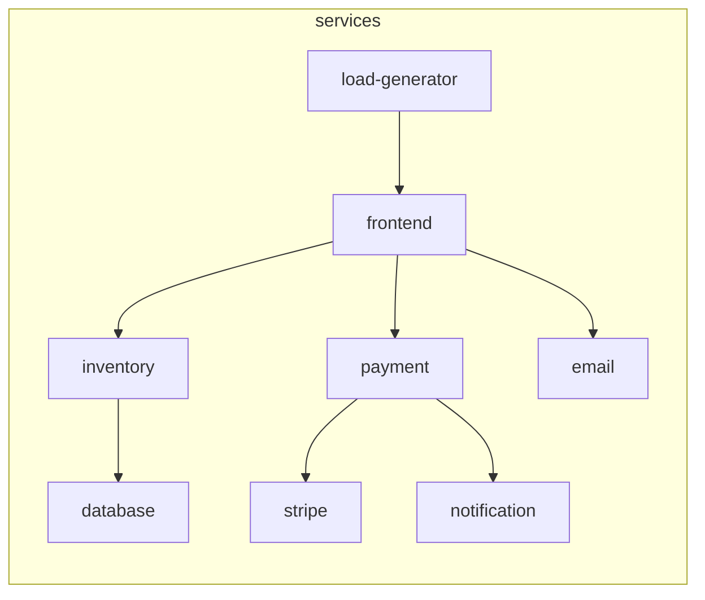

# Trace Visualization Guide

Visualize distributed traces and service dependencies using Sigiro's built-in ASCII and Mermaid renderers. All commands work in any terminal — no browser needed.

---

## Prerequisites

```sh {"name":"setup"}
export SIGIRO_ENDPOINT="${SIGIRO_ENDPOINT:-http://localhost:9999}"
# Hosted only: export SIGIRO_API_KEY=sk_<tenant>_<random>
# Authorization headers below are ignored by this local Open endpoint.
# Ensure data exists
SPANS=$(curl -sf -H "Authorization: Bearer ${SIGIRO_API_KEY}" \
  -X POST "${SIGIRO_ENDPOINT}/v1/query" \
  -d "SELECT count(*) FROM lake.sigiro_spans" | jq -r '.[0].count_star()')
echo "Spans available: ${SPANS:-0}"
```

---

## 1. Trace Waterfall

The waterfall shows a parent/child span tree with timing bars. Each line represents one span: its relative start time, duration bar, name, kind, service, and error status.

**Important:** `sigiro waterfall` attaches the DuckLake catalog directly and requires the server to be **stopped**. If the server is running, you will get a DuckDB lock error.

### Get a trace ID to visualize

```sh {"name":"pick-trace"}
# Pick the most recent trace with multiple spans (via HTTP for clean JSON)
TRACE_ID=$(curl -sf -H "Authorization: Bearer ${SIGIRO_API_KEY}" \
  -X POST "${SIGIRO_ENDPOINT}/v1/query" \
  -d "SELECT trace_id, count(*) AS n FROM lake.sigiro_spans GROUP BY trace_id ORDER BY n DESC, max(timestamp) DESC LIMIT 1" | jq -r '.[0].trace_id')
echo "Trace ID: ${TRACE_ID}"
```

### Render waterfall (server must be stopped)

```sh {"name":"waterfall"}
# Stop the server first if running
pkill -f "sigiro serve" 2>/dev/null || true
sleep 2

# Waterfall reads DuckLake directly
sigiro waterfall "${TRACE_ID}"
```

**Example output:**

```
Trace: aabbccdd11223344aabbccdd11223344
Spans: 7  Total duration: 1.234s

                                        POST /checkout    SERVER frontend     ROOT  1.234s
                              ████████████████████      POST /pay           CLIENT payment       1.100s
                                    ████████              charge-card         CLIENT stripe        0.450s
                              ██████████                GET /inventory      CLIENT inventory     0.800s
                                        ████            send-email          CLIENT email         0.200s
```

**How to read it:**
- Left-aligned bar = span starts at trace beginning
- Right-aligned bar = span starts later (relative offset)
- Bar width = duration relative to the longest span
- `SERVER` = incoming request, `CLIENT` = outgoing call
- `[ERR]` = span has status_code = 2 (ERROR)
- `ROOT` = no parent_span_id

---

## 2. Trace Tree

A hierarchical tree view with ASCII connectors showing the call hierarchy. Works through the HTTP API — server can be running.

```sh {"name":"trace-tree"}
sigiro trace-tree "${TRACE_ID}"
```

**Example output:**

```
Trace: aabbccdd11223344aabbccdd11223344
Spans: 23  Duration: 0.00ms

├─ frontend [frontend] 0.00ms
└─ ├─ ├─ hipstershop.RecommendationService/ListRecommendations [frontend] 0.00ms
     │  ├─ /hipstershop.RecommendationService/ListRecommendations [recommendationservice] 0.00ms
        │  ├─ /hipstershop.ProductCatalogService/ListProducts [recommendationservice] 0.00ms
           │  └─ hipstershop.ProductCatalogService/ListProducts [productcatalogservice] 0.00ms
```

**How to read it:**
- `├─` = sibling, `└─` = last child
- `│` = continues up to parent
- `[service_name]` = which service emitted the span
- `0.00ms` = duration (some instrumentation sends zero-duration spans)
- `[ERR]` = error status

### Get trace detail via HTTP (with critical path)

```sh {"name":"trace-detail-http"}
curl -sf -H "Authorization: Bearer ${SIGIRO_API_KEY}" \
  "${SIGIRO_ENDPOINT}/v1/traces/${TRACE_ID}" | jq '{
    trace_id,
    span_count,
    total_duration_ms: (.total_duration_ns / 1e6),
    critical_path,
    service_breakdown
  }'
```

---

## 3. Service Topology

### ASCII dependency tree

Shows which services call which. Roots are services with no incoming dependencies.

```sh {"name":"topo-ascii-full"}
sigiro topology
```

**Example output:**

```
Service Dependencies
====================

└─ frontend
└─ sigiro
└─ productcatalogservice
└─ currencyservice
└─ recommendationservice
└─ checkoutservice
└─ paymentservice
└─ emailservice
```

**Note:** Arrows (`→ [dep1, dep2]`) only appear when cross-service CLIENT spans exist in the same traces. If your instrumentation doesn't propagate trace context between services, the topology will be flat.

### Focus on one service

```sh {"name":"topo-ascii-focus"}
sigiro topology frontend
```

### Mermaid flowchart

Generate a Mermaid diagram for pasting into GitHub, Notion, or any Mermaid renderer:

```sh {"name":"topo-mermaid"}
sigiro topology --format mermaid
```

**Example output:**



### Mermaid for a focused service

```sh {"name":"topo-mermaid-focus"}
sigiro topology frontend --format mermaid
```

### Topology via HTTP

```sh {"name":"topology-http"}
# Get services list
curl -sf -H "Authorization: Bearer ${SIGIRO_API_KEY}" \
  "${SIGIRO_ENDPOINT}/v1/services" | jq '.services[].name'

# Investigate each service to get dependencies
curl -sf -H "Authorization: Bearer ${SIGIRO_API_KEY}" \
  -H "Content-Type: application/json" \
  -X POST "${SIGIRO_ENDPOINT}/v1/diagnose" \
  -d '{"services":["frontend"],"from_ts":1780000000000000,"to_ts":1780001800000000}' | jq '.frontend.context | {dependencies, dependents}'
```

---

## 4. Finding Interesting Traces

### Longest traces

```sh {"name":"longest-traces"}
sigiro query "SELECT trace_id, count(*) AS span_count, max(duration)/1e6 AS max_ms, sum(duration)/1e6 AS total_ms FROM lake.sigiro_spans GROUP BY trace_id HAVING count(*) > 3 ORDER BY total_ms DESC LIMIT 10"
```

### Traces with errors

```sh {"name":"error-traces"}
NOW_US=$(python3 -c "import time; print(int(time.time()*1e6))")
FROM_US=$((NOW_US - 3600 * 1000000))
sigiro query "SELECT trace_id, count(*) AS spans, count(*) FILTER (WHERE status_code = 2) AS errors FROM lake.sigiro_spans WHERE timestamp > make_timestamp(${FROM_US}) GROUP BY trace_id HAVING errors > 0 ORDER BY errors DESC LIMIT 10"
```

### Cross-service traces (distributed)

```sh {"name":"distributed-traces"}
sigiro query "SELECT trace_id, count(DISTINCT service_name) AS services, count(*) AS spans FROM lake.sigiro_spans GROUP BY trace_id HAVING services > 1 ORDER BY spans DESC LIMIT 10"
```

### Full span timeline for a trace

```sh {"name":"trace-timeline"}
TRACE_ID=$(curl -sf -H "Authorization: Bearer ${SIGIRO_API_KEY}" \
  -X POST "${SIGIRO_ENDPOINT}/v1/query" \
  -d "SELECT trace_id FROM lake.sigiro_spans LIMIT 1" | jq -r '.[0].trace_id')
sigiro query "SELECT span_name, service_name, span_kind, status_code, duration / 1e6 AS ms, timestamp::VARCHAR AS ts FROM lake.sigiro_spans WHERE trace_id = '${TRACE_ID}' ORDER BY timestamp"
```

---

## 5. Rendering Tips

### For AI agents / LLM consumption

Use `--format json` with `jq` to extract exactly what the agent needs:

```sh {"name":"agent-extract"}
TRACE_ID=$(curl -sf -H "Authorization: Bearer ${SIGIRO_API_KEY}" \
  -X POST "${SIGIRO_ENDPOINT}/v1/query" \
  -d "SELECT trace_id FROM lake.sigiro_spans ORDER BY timestamp DESC LIMIT 1" | jq -r '.[0].trace_id')

# Compact: just the call hierarchy
curl -sf -H "Authorization: Bearer ${SIGIRO_API_KEY}" \
  "${SIGIRO_ENDPOINT}/v1/traces/${TRACE_ID}" | jq '[.spans[] | {name: .span_name, service: .service_name, parent: .parent_span_id, ms: (.duration_ns/1e6), error: (.status_code==2)}]'

# Critical path only
curl -sf -H "Authorization: Bearer ${SIGIRO_API_KEY}" \
  "${SIGIRO_ENDPOINT}/v1/traces/${TRACE_ID}" | jq '.critical_path'

# Service breakdown with percentages
curl -sf -H "Authorization: Bearer ${SIGIRO_API_KEY}" \
  "${SIGIRO_ENDPOINT}/v1/traces/${TRACE_ID}" | jq '.service_breakdown'
```

### For terminal screenshots

The ASCII output is designed to look good in terminals. Pipe to `cat` to prevent paging:

```sh {"name":"terminal-friendly"}
# Waterfall (server stopped)
pkill -f "sigiro serve" 2>/dev/null || true
sleep 1
sigiro waterfall "${TRACE_ID}" | cat

# Tree (server running)
sigiro trace-tree "${TRACE_ID}" | cat
sigiro topology | cat
```

---

## Quick Reference

| Command | What it shows | Best for | Server state |
|---------|--------------|----------|-------------|
| `sigiro waterfall <trace_id>` | Timing bars + hierarchy | Spotting bottlenecks | **Stopped** |
| `sigiro trace-tree <trace_id>` | ASCII tree with connectors | Deep call stacks, error propagation | Running |
| `sigiro topology` | Service dependency graph | Architecture review | Running |
| `sigiro topology --format mermaid` | Mermaid flowchart | Documentation, PRs | Running |
| `GET /v1/traces/{id}` | Full detail + critical path | Programmatic analysis | Running |
