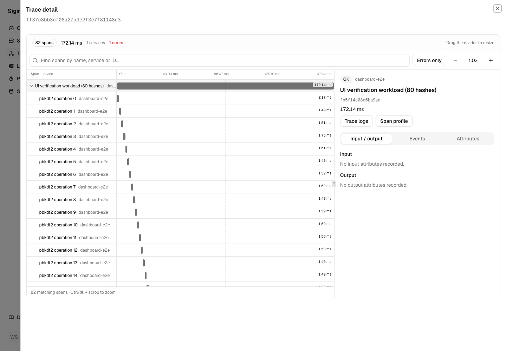
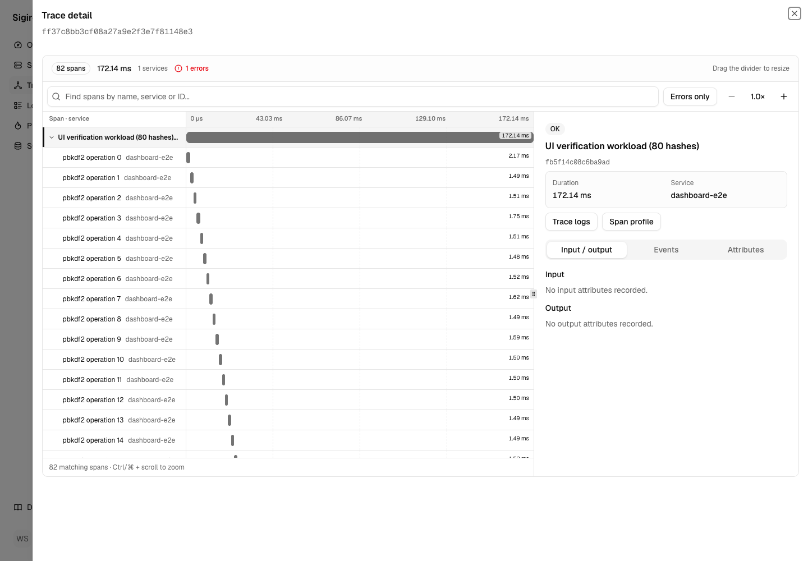
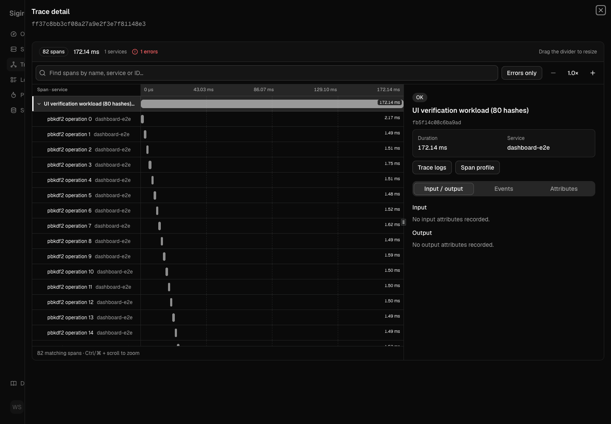
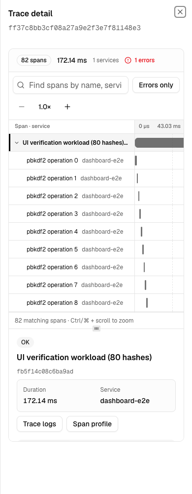

# Trace workspace polish

Make the existing trace workflow easier to read, select, and navigate without changing its data or query model.

## Changes

- A selected-row rail and stronger title weight survive grayscale viewing.
- Errors have a symbol as well as text and color.
- Timeline labels are 11px rather than 10px. Inspector duration and service have explicit labels.
- Collapse controls have 24px targets. Timeline controls stay together on narrow screens.
- Focus outlines use solid, theme-aware contrast. Muted and semantic text colors are darker in light mode.
- Reduced-motion preferences suppress animations, transitions, and smooth scrolling.
- Search results use a polite live region.

The live [telemetry.dev](https://telemetry.dev) homepage was inspected in Chromium on 2026-11-09, including its trace-workspace product screenshot. The useful precedents were its quiet grid, selected-row rail, and compact inspector metrics, not its marketing layout. Existing shadcn components and Laminar attribution remain intact.

## Artifact verification

Code commit `a59b0ef4b2dfa237d45aa1669980e2d5cacd5e64` was rebuilt and checked after rebasing onto merged PR #167.

Production `next build` and TypeScript checks passed. A separate static preview on port 19993 uses the existing open-mode backend on 19997. Release preview 19996 and backend processes were not restarted or changed.

Real trace `ff37c8bb3cf08a27a9e2f3e7f81148e3` has 82 spans. Chromium checks used 1440×1000 and 390×1000 viewports in actual light and dark themes with reduced motion enabled.

| Sample | Before, affected axe nodes | After, affected axe nodes |
| --- | ---: | ---: |
| Light desktop | 6 | 0 |
| Light mobile | 2 | 0 |
| Dark desktop | 1 | 0 |
| Dark mobile | 1 | 0 |

axe-core scanned WCAG 2 A/AA, 2.1 AA, and 2.2 AA rules against each rendered document. Baseline failures were muted/status color contrast and a 20px collapse target. See [raw axe results](assets/trace-polish/axe-results.json).

Search matching and empty results, keyboard span selection with URL state, visible keyboard focus, zoom in/reset, viewport overflow, and uncaught browser errors were checked for all four final states. All passed. Search and keyboard checks ran after the screenshot/axe sample. No real data was created or modified.

## Evidence

| Before | After |
| --- | --- |
|  |  |

## Limits

This is not WCAG certification or a full screen-reader audit. Automated scans cover sampled states, not every dashboard route, color pairing, payload, or interaction. Hosted authentication and deployment are outside this follow-up. Existing 2,000-span truncation and horizontal timeline scrolling remain. Global tokens and reduced-motion rules also affect other dashboard screens; they are intentional shared improvements, but this pass does not claim exhaustive verification of those screens.
