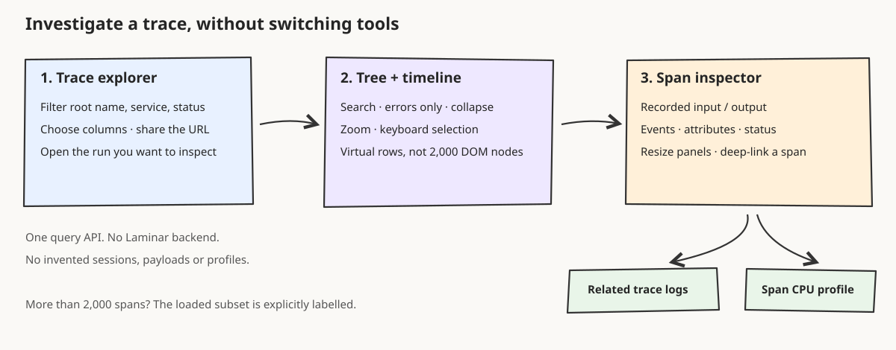
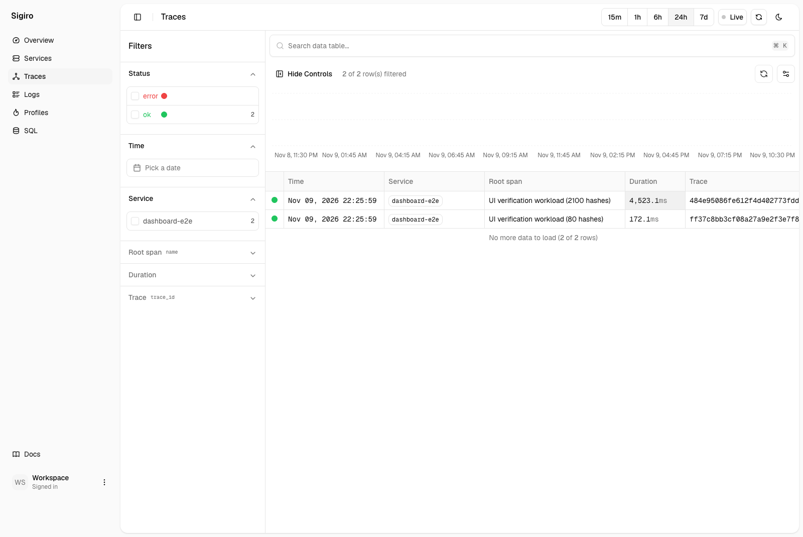
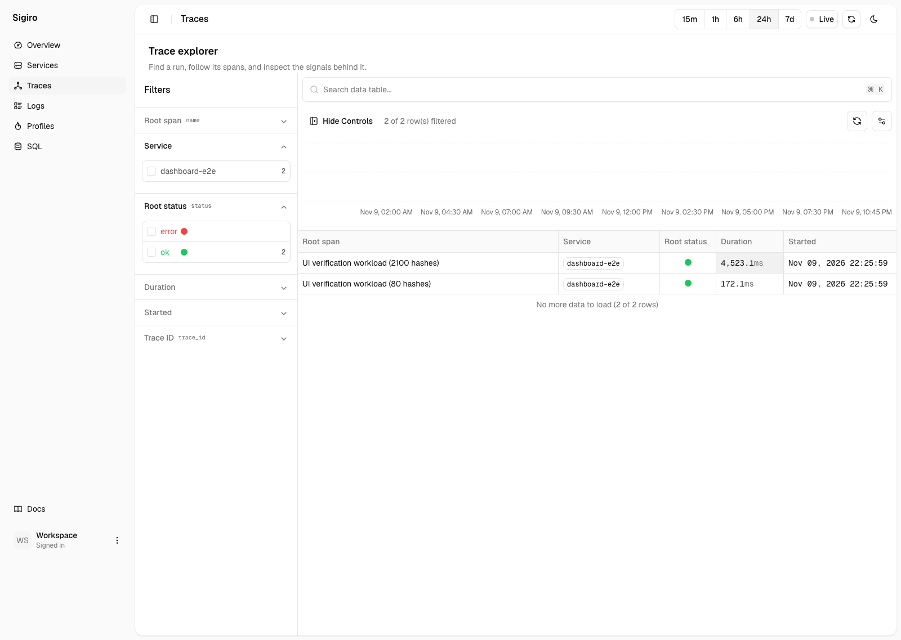
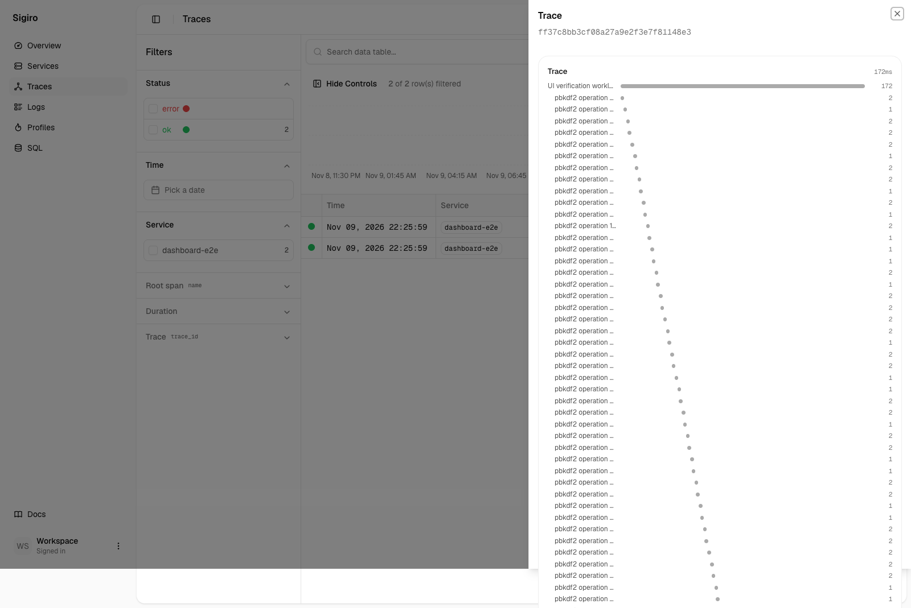
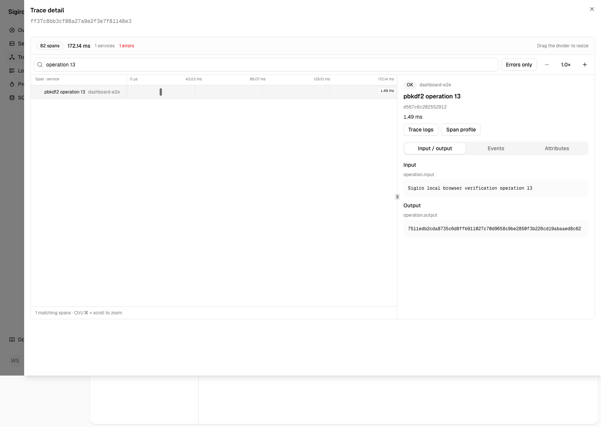

# Trace workspace verification

The dashboard now opens a trace as a wide investigation workspace. Laminar's timeline interaction informed the layout. Sigiro's existing query API, explorer filters, and shadcn shell remain in place.



## Verified artifact

- Runtime source revision `0b8f97df8c93813992e413784d5f2884c2005579`.
- Baseline source revision `3c801fbe861cdcebfeaaa7046949606fb05c34d2`.
- Production static export, served over loopback HTTP. No Next development server.
- Static manifest SHA-256 `c5da88c0948c103591d23dd7ef844830c9011ebc697a2e94039f2a5f8bab6138`. Computed over sorted relative paths, NUL delimiters, and each file's SHA-256 bytes in `dashboard/dist`.
- Local Sigiro 0.1.0 backend binary SHA-256 `c4a4b4ae265ff84ad5efc4bd2d5fcd2d8759be228458847e13c480637e69bec1`.
- TypeScript check, production build, targeted oxlint, and diff whitespace check pass.

## Browser evidence

Chrome drove the exported app against real `/v1/query` responses. The dedicated local dataset contains measured PBKDF2 operations, a real HTTP 404, and their OTLP spans and logs. These are verification workloads, not customer or LLM runs. The browser did not intercept or fabricate API responses.

The [21 recorded checks](assets/trace-workspace/browser-results.json) cover the column picker, URL-restored filter, row-to-detail navigation, collapse, span search, recorded input and output, events, attributes, errors-only, zoom buttons, Ctrl-wheel zoom, keyboard navigation, panel resizing, reload, close, truncation, virtualization, invalid IDs, empty traces, logs, profile links, mobile overflow, and runtime errors. Some checks cover multiple related assertions.

The 2,102-span workload is visibly capped at 2,000 spans. Fewer than 70 span rows are mounted at either scroll boundary. This proves bounded rendering for that trace, not an unlimited-trace performance claim.

Two additional browser checks passed:

- Stopping only the dedicated backend produces a visible 502. Restarting it and clicking **Retry trace query** restores the 2,000-span workspace. The [outage screenshot](assets/trace-workspace/after-query-error.png) records the actual transport failure.
- A read-only existing Rust workload links from its trace and selected span into a [real CPU profile](assets/trace-workspace/related-profile.png), showing 60 ms across five stacks. The verification did not write to that dataset.

### Screenshots

| Surface | Before | After |
| --- | --- | --- |
| Explorer |  |  |
| Detail |  |  |

Also captured: [error inspector](assets/trace-workspace/after-error.png), [large trace](assets/trace-workspace/after-large.png), [dark theme](assets/trace-workspace/after-dark.png), and [390 px mobile](assets/trace-workspace/after-mobile.png).

## Bugs found during verification

- Span selection through a server navigation reset local filters. Selection now uses shallow nuqs URL state.
- The Logs page used SQL `hash()`, which the backend rejects. Browser SHA-256 now computes row identities from the same fields.
- A trace-to-logs link used unsupported `from` and `to` parameters. It now uses the table's timestamp-range encoding and the loaded trace window.
- The column picker had no accessible name. It now exposes **Configure columns**.
- Trace and explorer query failures were not actionable. Both expose errors and retry controls.

## Scope and limits

- The explorer lists root spans. **Root status** is not a roll-up of child failures.
- Only the first 2,000 spans load. The UI labels subset timing and counts. There is no server pagination for complete large traces.
- Input and output are recorded attributes grouped by key. Provider-specific message rendering and content recorded only in events are not reconstructed. All attributes and raw events remain inspectable.
- Search matches span names, services, and IDs. Search text, collapse state, error filter, zoom, and divider position are local state. Explorer filters and selected trace/span are URL state.
- A profile link can correctly open an empty result when no linked samples exist.
- Sessions, replay, model costs, and token charts were not added.
- Browser checks used local open mode. Hosted OAuth, production data volume, and deployed behavior are unverified. Nothing was deployed or merged.
- Reviewer `7a4cfe51` found no blockers in a read-only source review of isolation, auth/query boundaries, URL state, async state, links, and payload rendering. This was a same-family, context-isolated review, not browser verification or cross-family independence.

## Reproduce locally

Use an isolated local data directory. The workload script writes telemetry to the loopback backend.

```sh
sigiro serve --data-dir /tmp/sigiro-trace-ui-data --http-port 19997 --otlp-http-port 14348 --otlp-grpc-port 14347
```

In the dashboard directory, install dependencies, build, and generate the measured workload.

```sh
aube install
npm run typecheck
npm run build
python3 scripts/trace-workspace-workload.py
node scripts/serve-trace-workspace.mjs
```

In another terminal in the dashboard directory, run the browser checks. Install Playwright's Chromium first if no browser is available. Alternatively, set `BROWSER_EXECUTABLE` to a local Chromium executable.

```sh
npx playwright install chromium
node scripts/trace-workspace-e2e.mjs
```

The scripts support `DASHBOARD_URL`, `TRACE_FIXTURE`, `SCREENSHOT_DIR`, `BROWSER_EXECUTABLE`, `STATIC_ROOT`, `BACKEND_PORT`, `PORT`, `SIGIRO_E2E_HTTP_PORT`, and `SIGIRO_E2E_OTLP_PORT`. Defaults target the isolated ports above. Screenshots and the JSON check record are regenerated by the browser script. Before screenshots were built separately from the baseline revision against the same backend and data.

## Reuse and attribution

Laminar revision `99d1eae1faa7d779ab11c4deaafca7659c143442` provided the inspected condensed timeline, wheel-zoom, and span-content source. The adapted wheel-zoom hook ships with the [Apache-2.0 license](../dashboard/public/licenses/laminar-Apache-2.0.txt) and [modification notice](../dashboard/public/licenses/laminar-NOTICE.txt). The shadcn resizable registry component supplies the divider. Existing openstatus table controls and EvilCharts supply the explorer. No Laminar store or backend was imported.

The domain model uses an iterative span forest and visited IDs rather than recursive rendering. The lazy implementation choice retains existing explorer controls instead of adding a second table stack. The experience-first choice puts the tree, timing, and payload next to each other instead of expanding the narrow property sheet.
